<div align="center">


# LuxeAccent

**A modern e-commerce mobile app for premium accessories, built with Flutter.**


[Overview](#-overview) · [Screenshots](#-screenshots) · [Features](#-features) · [Tech Stack](#-tech-stack) · [Architecture](#-architecture) · [Getting Started](#-getting-started) · [Status](#-project-status)

</div>

---

## 📖 Overview

**LuxeAccent** is a shopping app for jewelry, bags, scarves, eyewear and watches. It focuses on a clean, modern interface and a smooth path from browsing to checkout: discover offers and categories, open a product, pick a color, read reviews, and manage the cart.

The app talks to a live REST API for authentication, products, reviews and offers, and ships with a full **light / dark theme**.

> Developed by a team of six developers as a graduation project.

## 📸 Screenshots

> UI design preview of the app screens.

### Getting in

<table>
  <tr>
    <td align="center" valign="top">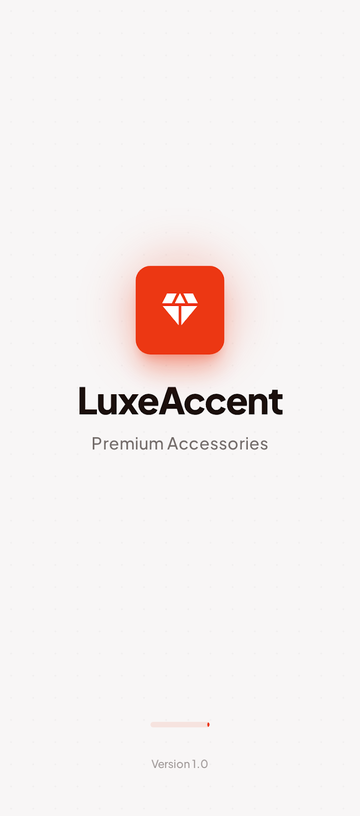<br /><sub><b>Splash</b></sub></td>
    <td align="center" valign="top">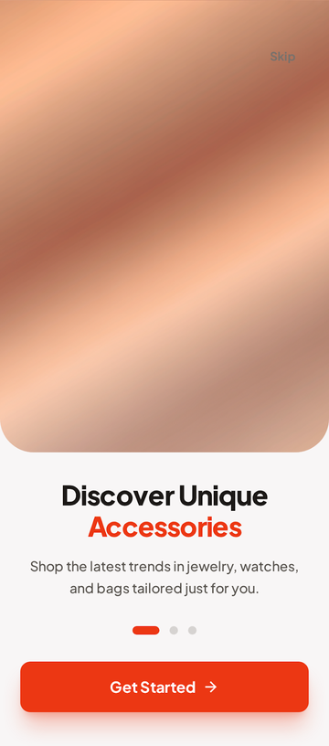<br /><sub><b>Onboarding</b></sub></td>
    <td align="center" valign="top">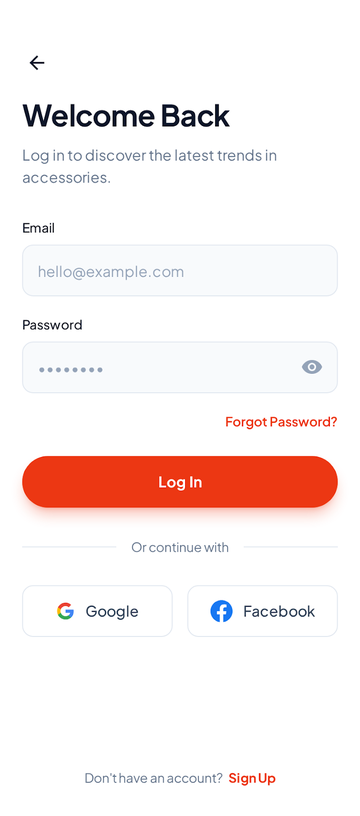<br /><sub><b>Login</b></sub></td>
    <td align="center" valign="top">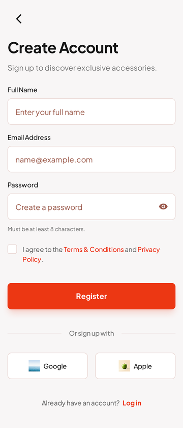<br /><sub><b>Create Account</b></sub></td>
  </tr>
</table>

### Account recovery & verification

<table>
  <tr>
    <td align="center" valign="top">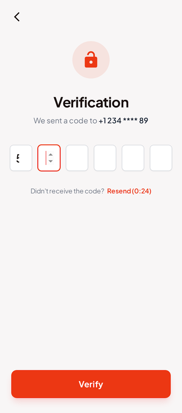<br /><sub><b>Verification</b></sub></td>
    <td align="center" valign="top">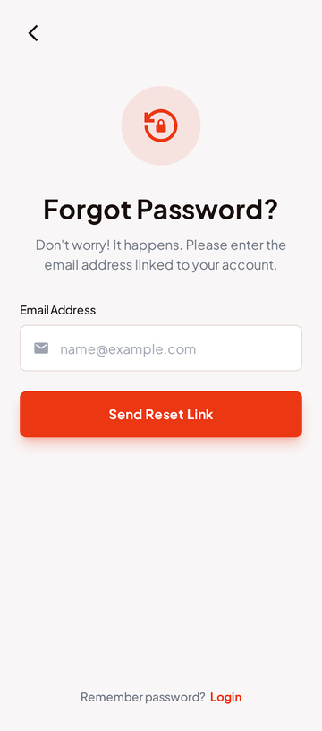<br /><sub><b>Forgot Password</b></sub></td>
    <td align="center" valign="top">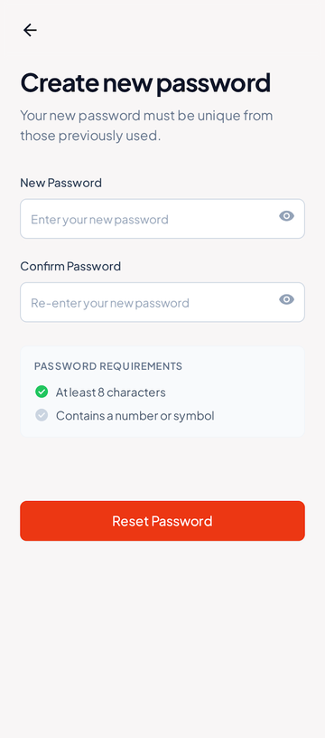<br /><sub><b>New Password</b></sub></td>
    <td align="center" valign="top">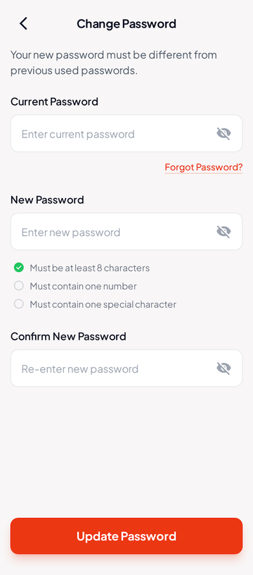<br /><sub><b>Change Password</b></sub></td>
  </tr>
</table>

### Shopping

<table>
  <tr>
    <td align="center" valign="top">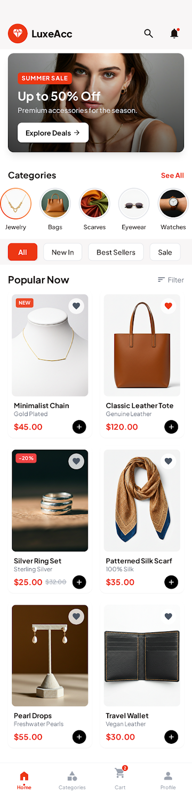<br /><sub><b>Home</b></sub></td>
    <td align="center" valign="top">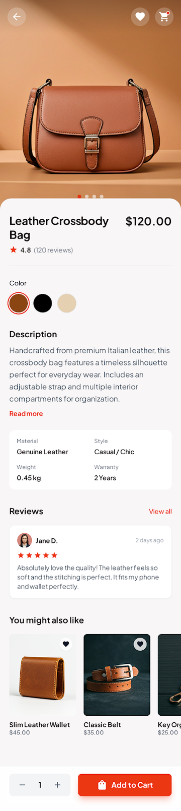<br /><sub><b>Product Details</b></sub></td>
    <td align="center" valign="top">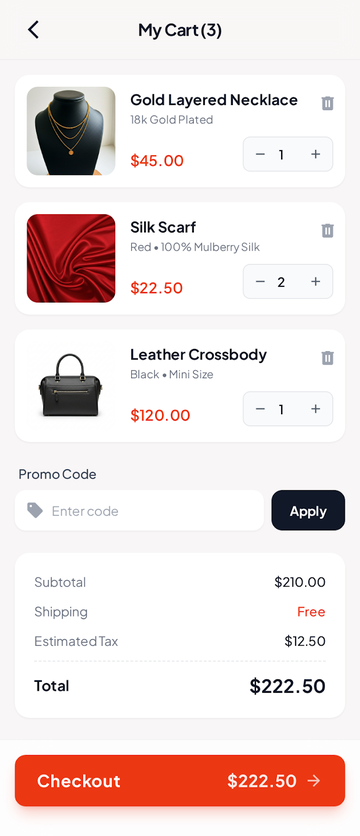<br /><sub><b>Cart</b></sub></td>
  </tr>
</table>

### Profile, support & products management

<table>
  <tr>
    <td align="center" valign="top">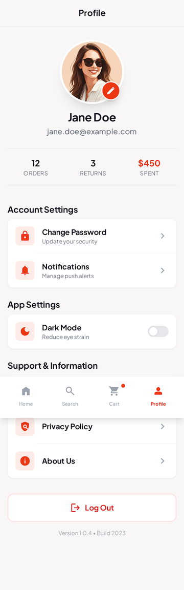<br /><sub><b>Profile</b></sub></td>
    <td align="center" valign="top">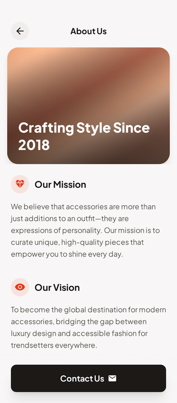<br /><sub><b>About Us</b></sub></td>
    <td align="center" valign="top">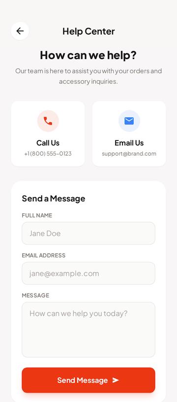<br /><sub><b>Help Center</b></sub></td>
    <td align="center" valign="top">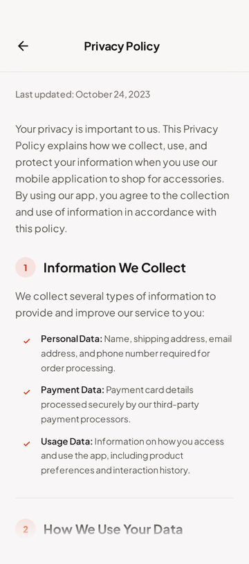<br /><sub><b>Privacy Policy</b></sub></td>
  </tr>
  <tr>
    <td align="center" valign="top">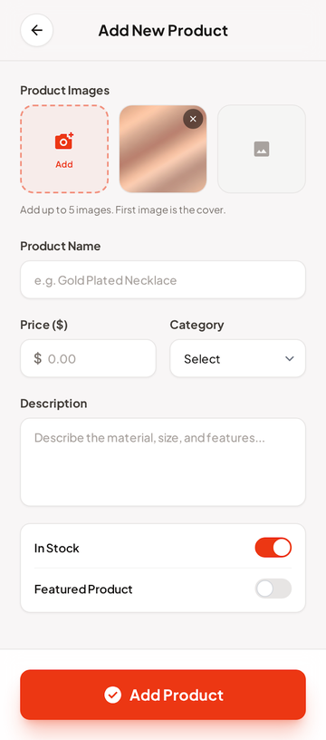<br /><sub><b>Add New Product</b></sub></td>
    <td></td>
    <td></td>
    <td></td>
  </tr>
</table>

## ✨ Features

**Authentication**
- Register, log in and log out against the backend API
- Email verification with a 6-digit PIN input
- Create a new password and change password
- Form validation for email, password, phone and name
- Auth token saved locally and attached automatically to every request

**Home**
- Offers banner carousel loaded from the API
- Category row with filtering (Jewelry, Bags, Scarves, Eyewear, Watches)
- "Popular Now" products grid loaded from the API
- Floating liquid-glass bottom navigation: Home · Products · Cart · Profile

**Products**
- Product listing and rich product details: image header, color variants, description, specs (material, style, weight, warranty)
- Ratings and customer reviews loaded per product
- Quantity selector and Add to Cart bar
- "Add New Product" form

**Cart**
- Quantity controls and item removal
- Promo code field
- Order summary: subtotal, shipping, estimated tax and total
- Checkout button with the live total

**Profile & settings**
- Account settings and change password
- **Dark mode** toggle (state managed with a `ThemeCubit`)
- About Us, Help Center (contact form), Privacy Policy entry and Log out

## 🛠 Tech Stack

| Area | Tools |
| --- | --- |
| Framework | Flutter, Dart (SDK `^3.9.2`) |
| Networking | [`dio`](https://pub.dev/packages/dio) with an interceptor that injects the Bearer token |
| State management | [`flutter_bloc`](https://pub.dev/packages/flutter_bloc) (`ThemeCubit`) and stateful widgets |
| Local storage | [`shared_preferences`](https://pub.dev/packages/shared_preferences) (auth token) |
| UI packages | `carousel_slider`, `flutter_rating_bar`, `flutter_svg`, `pin_code_fields`, `liquid_glass_navbar`, `floating_draggable_widget` |
| Typography | Plus Jakarta Sans, Playfair |
| Theming | Light & dark themes, see [`THEME_IMPLEMENTATION_GUIDE.md`](THEME_IMPLEMENTATION_GUIDE.md) |

## 🏗 Architecture

The project uses a **feature-first** structure. Each feature keeps its own data layer (models and repositories) and presentation layer (screens and widgets), while shared code lives in `core`.

```text
lib/
├── core/
│   ├── constants/        # colors, images, light & dark themes
│   ├── helpers/          # validators, shared preferences, layout helpers
│   ├── network/          # Dio client, API service, error handling
│   ├── shared_widgets/   # reusable buttons, text, app bar, snack bar
│   └── theme/            # ThemeCubit & ThemeState
├── features/
│   ├── splash/           # splash + onboarding
│   ├── auth/             # login, register, verification, create password
│   ├── home/             # banner, categories, popular products
│   ├── products/         # list, details, reviews, add product
│   ├── cart/             # cart items, promo code, order summary
│   └── profile/          # settings, about, help, change password
│       └── (each feature)  data/ { models, repo }  ·  presentation/ { screens, widgets }
├── root.dart             # bottom navigation shell
└── main.dart             # app entry & theme setup
```

### API endpoints used

| Feature | Endpoint |
| --- | --- |
| Auth | `POST /auth/register` · `POST /auth/login` · `POST /auth/verify-email` · `POST /auth/logout` · `POST /auth/change-password` |
| Products | `GET /products` (paginated) |
| Reviews | `GET /reviews/{productId}` |
| Offers | `GET /offers` |

## 🚀 Getting Started

**Prerequisites:** [Flutter SDK](https://docs.flutter.dev/get-started/install) with Dart `^3.9.2`, and an Android emulator, iOS simulator or physical device.

```bash
# 1. Clone the repository
git clone https://github.com/Ahmed-Elzaher/luxe-ecommerce-app.git
cd luxe-ecommerce-app

# 2. Install dependencies
flutter pub get

# 3. Run the app
flutter run
```

The API base URL is set in [`lib/core/network/dio_client.dart`](lib/core/network/dio_client.dart).

## 📌 Project Status

| Area | Status |
| --- | --- |
| Authentication, products, reviews, offers | Connected to the REST API |
| Light / dark theme | Done |
| Cart | Works on local state with sample items |
| Add New Product | UI form, not yet connected to the API |
| Checkout & payment | Not implemented yet |

## 👥 Team

Built by a team of six developers. See the [contributors](../../graphs/contributors) page for everyone who worked on the project.
